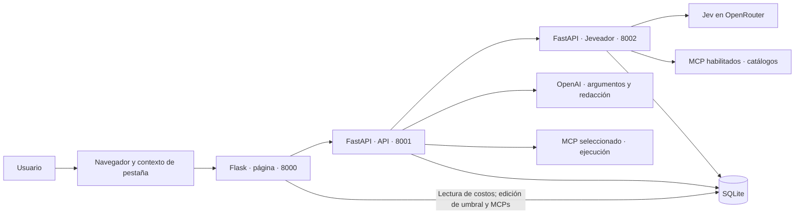
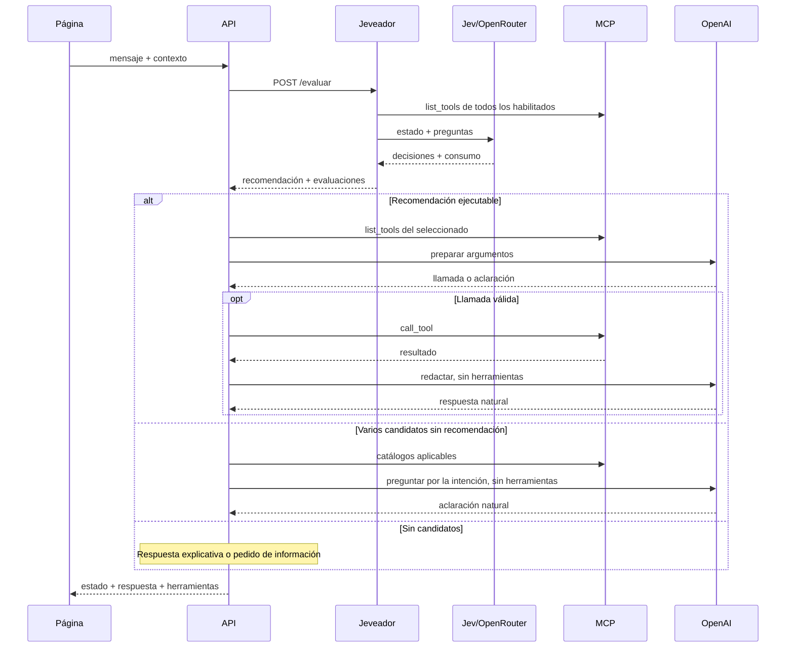

# Arquitectura de JEV

Actualizada el 12 de octubre de 2026 a partir del código. Este documento describe la implementación actual, sus contratos y sus límites. Reemplaza la propuesta inicial de sesiones persistentes. No se inspeccionaron archivos `.env`, credenciales ni bases configuradas; las variables y tablas se documentan según el código.

## Cómo se desarrolló

Este proyecto se desarrolló mediante **vibe coding**, con asistencia de inteligencia artificial para generar e iterar sobre el código, y fue **verificado manualmente por su autor**. La verificación manual complementa las pruebas automatizadas descritas en este documento; no garantiza que el proyecto esté libre de errores.

## Configuración inicial

Antes de iniciar el chat, creá las cuentas de los dos proveedores y los tres archivos de configuración local descritos abajo. Los ejemplos contienen claves ficticias: reemplazalas únicamente en tu máquina.

### 1. Crear cuentas y generar las claves de API

**OpenAI**, para preparar argumentos y redactar respuestas:

1. Entrá a [OpenAI Platform](https://platform.openai.com/) y creá una cuenta o iniciá sesión.
2. En tu proyecto, abrí [API keys](https://platform.openai.com/api-keys) y generá una clave de API.
3. Guardala localmente como `API_KEY` en `api/.env`. Este proyecto usa ese nombre, en lugar de `OPENAI_API_KEY`.
4. Revisá la facturación y el acceso al modelo que vayas a configurar antes de realizar consultas.

Referencia: [documentación oficial de OpenAI: primeros pasos y creación de claves](https://developers.openai.com/api/docs/quickstart).

**OpenRouter**, para las decisiones de Jev:

1. Entrá a [OpenRouter](https://openrouter.ai/) y creá una cuenta o iniciá sesión.
2. Abrí [API keys](https://openrouter.ai/settings/keys) y generá una clave de API.
3. Guardala localmente como `JEV_KEY` en `jeveador/.env`.
4. Revisá el saldo, la facturación y el acceso al modelo Jev elegido antes de realizar consultas. Para usar Jev a través de OpenRouter no hace falta una cuenta adicional en TypeSafe.

Referencia: [documentación oficial de Jev en OpenRouter](https://openrouter.ai/docs/guides/community/jev).

Las claves de ambos proveedores son distintas y no se intercambian. Las consultas reales pueden generar cargos en cada proveedor. No publiques las claves en GitHub, capturas ni mensajes.

### 2. Crear los archivos `.env`

Creá manualmente un archivo llamado exactamente `.env` en cada una de estas carpetas: `api/`, `jeveador/` y `pagina/`. En Windows, comprobá que no se guarde como `.env.txt`. Si ya tenés esos archivos, actualizá solo lo necesario sin sobrescribir tu configuración.

**`api/.env`**:

```dotenv
API_KEY=REEMPLAZAR_CON_TU_CLAVE_OPENAI
MODELO_OPENAI=gpt-4.1-mini
JEV_URL=http://127.0.0.1:8002/evaluar
MCP_AUTOS_URL=http://127.0.0.1:8003/mcp
MAX_RONDAS=5
CADENA=../sqlserver/base.db
MAX_CONTEXTO=20
```

**`jeveador/.env`**:

```dotenv
JEV_KEY=REEMPLAZAR_CON_TU_CLAVE_OPENROUTER
JEV_URL=https://openrouter.ai/api/alpha/decisions
JEV_MODELO=typesafe/jev-1.13
CADENA=../sqlserver/base.db
MAX_CONTEXTO=20
```

El endpoint y el modelo de Jev del ejemplo están documentados en [OpenRouter](https://openrouter.ai/docs/guides/community/jev). Comprobá su disponibilidad en tu cuenta. `JEV_URL` en este archivo apunta al proveedor externo; en `api/.env` apunta al servicio Jeveador local.

**`pagina/.env`**:

```dotenv
API_URL=http://127.0.0.1:8001/chat/jev
CADENA=../sqlserver/base.db
MAX_CONTEXTO=20
PAGINA_SIZE=50
```

La página no necesita claves de los proveedores. Los MCP de ejemplo tampoco necesitan credenciales de OpenAI ni OpenRouter.

Las tres rutas `CADENA` del ejemplo resuelven al mismo archivo SQLite porque las carpetas de los servicios están al mismo nivel. Si usás otra ubicación, ajustá las tres para que apunten a la misma base. La base local está excluida de Git: estos archivos de configuración no crean sus tablas. Consultá la sección [SQLite](#sqlite) para los requisitos de inicialización.

Mantené `MAX_CONTEXTO` igual en los tres archivos y reiniciá los servicios después de cambiar la configuración. El `.gitignore` del proyecto excluye los `.env` y sus variantes; las claves reales deben quedar únicamente en la configuración local.

## Componentes

| Componente | Tecnología | Dirección habitual de desarrollo | Responsabilidad |
| --- | --- | --- | --- |
| `pagina/` | Flask, Jinja, HTML/CSS/JavaScript | `http://127.0.0.1:8000` | Chat, contexto de pestaña, costos, edición del umbral y administración de MCPs. |
| `api/` | FastAPI y Uvicorn | `http://127.0.0.1:8001` | Coordina Jeveador, OpenAI y ejecución MCP. |
| `jeveador/` | FastAPI y Uvicorn | `http://127.0.0.1:8002` | Evalúa capacidades mediante Jev/OpenRouter; no ejecuta tools. |
| `mcp_autos/` | FastMCP, Streamable HTTP | `http://127.0.0.1:8003/mcp` | Herramientas de ejemplo sobre autos. |
| `mcp_cocina/` | FastMCP, Streamable HTTP | `http://127.0.0.1:8004/mcp` | Herramientas de ejemplo sobre platos. |
| `mcp_clima/` | FastMCP, Streamable HTTP | `http://127.0.0.1:8005/mcp` | Última temperatura y probabilidad de precipitaciones del pronóstico horario para CABA, con fecha en GMT-3. |
| SQLite | `sqlite3` de Python | Archivo indicado por `CADENA` | Catálogo, costos y descripciones de errores. |
| OpenAI | Responses API por HTTPX | Servicio externo | Prepara argumentos, pide aclaraciones y redacta respuestas. |
| Jev/OpenRouter | API de decisiones por HTTPX | Servicio externo configurado | Decide cobertura, aplicabilidad y recomendación. |

Los puertos de API y Jeveador vienen de sus comandos de arranque. El navegador consulta Flask; Flask usa la URL completa de `API_URL`. La página consulta SQLite directamente para mostrar costos y administrar el umbral y el catálogo MCP. No existe un servidor SQL Server: `sqlserver/` es una carpeta. No hay backend Node.js.



## Rutas

| Servicio | Método y ruta | Uso |
| --- | --- | --- |
| Página | `GET /`, `GET /index.html` | Interfaz del chat. |
| Página | `POST /chat` | Valida entrada, consulta `API_URL` y devuelve texto. |
| Página | `GET /costos`, `GET /costos.html` | Consumos, filtros y paginación. |
| Página | `GET/POST /umbral`, `GET/POST /umbral.html` | Consultar y guardar el umbral de confianza como porcentaje. |
| Página | `GET/POST /mcps`, `GET/POST /mcps.html` | Listar MCPs y cambiar su habilitación. |
| Página | `POST /mcps/agregar` | Agregar nombre y URL; siempre deshabilitado. |
| Página | `GET/POST /mcps/<id_mcp>/borrar` | Mostrar confirmación y eliminar el registro mediante POST. |
| API | `GET /mejor_auto` | Ejecuta directamente la herramienta MCP, sin LLM. |
| API | `POST /es_mejor_auto` | Ejecuta directamente con el parámetro `auto`, sin LLM. |
| API | `POST /chat` | Chat original con OpenAI contra `MCP_AUTOS_URL`. |
| API | `POST /chat/jev` | Evalúa con Jeveador y coordina selección y ejecución. |
| Jeveador | `POST /evaluar` | Descubre catálogos y devuelve recomendación/evaluaciones. |

API y Jeveador tienen Swagger en `/docs`. Las rutas de negocio usan JSON; MCP usa su protocolo JSON-RPC sobre Streamable HTTP.

## Flujo principal: `/chat/jev`

1. El navegador manda el mensaje actual y contexto reciente a Flask.
2. Flask valida y reenvía a la API usando `cliente_api.py`. `API_URL` debe incluir `/chat/jev`: la página no agrega la ruta.
3. La API manda `mensaje` y `contexto` a `POST /evaluar` de Jeveador.
4. Jeveador lee `mcps` y consulta `list_tools()` de todos los servidores habilitados, con paginación.
5. Envía a Jev una solicitud con mensaje, contexto, catálogos y preguntas de intención/cobertura/aplicabilidad/recomendación. Las reglas se envían una sola vez en `state.reglas`.
6. Jeveador registra el consumo y valida las decisiones. Devuelve `mcp_recomendado` y una evaluación por MCP.
7. La API determina si usar la recomendación, responder sin coincidencias o pedir aclaración.
8. Para ejecutar, busca la URL del MCP recomendado en SQLite y exige que esté habilitado. Las URLs no proceden de la LLM.
9. Descubre nuevamente su catálogo y limita las herramientas a las recomendadas por Jeveador.
10. OpenAI prepara una llamada o pide datos. La API verifica nombre y argumentos mediante JSON Schema.
11. Ejecuta una herramienta por MCP y conserva el resultado completo.
12. Otra llamada OpenAI, sin herramientas habilitadas, redacta una respuesta natural con mensaje, contexto y resultado real.
13. La API devuelve el contrato del chat; Flask extrae `respuesta` y el navegador la muestra con Markdown sanitizado.

Para preguntas como «¿Qué podés hacer?» existe otra rama: Jev devuelve `intencion: "consultar_capacidades"` y los catálogos de los MCP habilitados. OpenAI redacta una explicación de esas capacidades sin ejecutar herramientas ni obtener sus resultados. Para un pedido concreto, la intención es `resolver_consulta` y se aplica el flujo de selección y ejecución anterior.



### Selección y continuidad

| Situación | Comportamiento |
| --- | --- |
| No hay candidatos ni datos pendientes | Respuesta explicativa, sin ejecución. |
| Hay recomendación válida | La API la usa aunque existan varios candidatos pertinentes. |
| Varios candidatos sin recomendación | Formula una pregunta natural usando sus capacidades reales; no ejecuta. |
| Faltan datos o cobertura parcial | Pide aclarar/completar antes de ejecutar. |
| OpenAI no solicita herramienta | Devuelve su aclaración. |
| OpenAI solicita varias herramientas | Pide precisar la primera operación. |
| Catálogo inconsistente, MCP deshabilitado o argumentos inválidos | Error HTTP; no ejecuta esa llamada. |

El usuario contesta normalmente, por ejemplo «un plato». La página manda la pregunta anterior y la respuesta como contexto; Jeveador vuelve a evaluar y la API selecciona. No hay un clasificador local de palabras. Jeveador valida las decisiones del proveedor y acepta una herramienta solo si su decisión es `aplicable` y su `confidence` supera estrictamente el umbral leído mediante `obtener_umbral()` en cada evaluación. Una confianza ausente, igual o inferior al umbral descarta la herramienta. El umbral proviene de `config_umbral`; si falla su lectura, se usa `UMBRAL_DEFECTO`, cuyo respaldo es 0.5 si no puede convertirse a decimal.

Si el filtro deja un MCP sin herramientas aceptadas, su evaluación pasa a `no_sirve`, sin pedir aclaración. Si era el recomendado, `mcp_recomendado` pasa a `null`, sin sustituirlo automáticamente por otro MCP. Si conserva solo parte de las herramientas de una evaluación `sirve`, pasa a `sirve_parcialmente`. Estos descartes no generan un 502. Las contradicciones interpretables de cobertura o recomendación se registran como advertencias y se normalizan conservadoramente: cobertura sin herramientas pasa a `no_sirve`, y recomendaciones sin herramientas pertinentes o incompatibles con la prioridad de cobertura pasan a `null`. Los estados, decisiones o candidatos desconocidos y las respuestas incompletas siguen produciendo un error de validación.

La evaluación y la preparación de argumentos dan prioridad al pedido explícito más reciente. El contexto sirve para interpretar referencias y confirmaciones, no para imponer una comparación anterior que el usuario ya aclaró o reemplazó. Si pide el mejor elemento de una categoría y existe una herramienta general sin argumentos, las instrucciones indican tratar ese pedido como completo, sin solicitar criterios de gusto o salud que no sean necesarios. Estas reglas son instrucciones a los modelos, no una garantía determinista de clasificación.

El campo `mcp` permanece opcional para clientes técnicos por compatibilidad. La página no lo necesita ni debe conocer identificadores internos. El ejemplo `"string"` de Swagger se normaliza como selección vacía.

### Confianza de Jev y significado del umbral

OpenRouter da acceso al modelo Jev de TypeSafe mediante su API de decisiones. La fórmula siguiente corresponde a respuestas de tipo `Choice` de Jev; no es una fórmula general para cualquier modelo ofrecido por OpenRouter. TypeSafe calcula `confidence` a partir de `probabilities` y el proveedor devuelve ambos campos. Jeveador utiliza el valor recibido para aplicar el filtro; no recalcula la confianza localmente.

Según la documentación oficial de TypeSafe, para una pregunta `Choice` con `n` opciones y probabilidad máxima `p_max`:

```text
confidence = (p_max - 1/n) / (1 - 1/n)
```

`n` es la cantidad de opciones de esa pregunta, no la cantidad de herramientas ni de MCP. En las preguntas de aplicabilidad hay dos opciones, `aplicable` y `no_aplicable`, por lo que la fórmula se simplifica a:

```text
confidence = 2 * p_max - 1
```

| Probabilidades de aplicabilidad | Decisión más probable | Confianza |
| --- | --- | --- |
| `aplicable: 0.51`, `no_aplicable: 0.49` | `aplicable` | `0.02` |
| `aplicable: 0.89`, `no_aplicable: 0.11` | `aplicable` | `0.78` |
| `aplicable: 0.00`, `no_aplicable: 1.00` | `no_aplicable` | `1.00` |

Una confianza alta expresa concentración en la decisión elegida, incluida una decisión de **no aplicar** la herramienta. No equivale a la probabilidad de aplicabilidad ni garantiza que la clasificación, los argumentos o la respuesta final sean correctos.

El umbral guardado en `config_umbral` se compara con `confidence`, no directamente con `probabilities["aplicable"]`. Para estas preguntas binarias, exigir `confidence > umbral` equivale, cuando la decisión es `aplicable`, a exigir:

```text
probabilities["aplicable"] > (umbral + 1) / 2
```

Por ejemplo, un umbral de confianza de `0.60` (60% en la página) exige una probabilidad de aplicabilidad superior a `0.80`; un umbral de `0.80` exige una probabilidad superior a `0.90`. La igualdad no basta, porque el filtro actual usa `>`.

Fuentes oficiales de respaldo:

- [TypeSafe: Confidence, sección Choice y fórmula de cálculo](https://docs.typesafe.ai/confidence#choice).
- [OpenRouter: Jev (TypeSafe), integración y referencias a la documentación del proveedor](https://openrouter.ai/docs/guides/community/jev).

### Contratos

Entrada mínima de `/chat/jev`:

```json
{"mensaje": "¿Cuál es el mejor auto?"}
```

Continuación con contexto:

```json
{
  "mensaje": "un plato",
  "contexto": [
    "Usuario: ¿Cuál es el mejor?",
    "Asistente: ¿Te referís a un auto o a un plato?"
  ]
}
```

Respuesta pública de `/chat` y `/chat/jev`:

```json
{
  "estado": "Ok",
  "respuesta": "Texto para el usuario.",
  "herramientas": ["mejor_auto"]
}
```

Aclaraciones y respuestas sin coincidencias conservan `estado: "Ok"` y `herramientas: []`. `Ok` indica que se produjo una respuesta, no que necesariamente se ejecutó una operación. Los estados internos y el resultado MCP completo no se exponen en este contrato. Un `isError` del protocolo se comunica en el texto.

Jeveador devuelve `intencion`, `mcp_recomendado` (nombre o `null`), `evaluaciones` y `capacidades`. Cada evaluación tiene `estado`, `mcp_evaluado`, `motivo`, `herramientas_aplicables` y `requiere_aclaracion`. Los estados son `sirve`, `sirve_parcialmente`, `no_sirve` y `falta_informacion`. En una consulta de capacidades devuelve los catálogos, sin recomendar una ejecución ni aplicar el umbral de herramientas.

Una recomendación `null` puede indicar ausencia de candidatos, ambigüedad o una recomendación descartada por inconsistencia o confianza insuficiente; la API distingue mediante las evaluaciones. Jeveador registra una recomendación `null` con un único candidato pertinente como inconsistente, pero la conserva sin producir un 502 ni ejecutar automáticamente.

### Respuesta cuando no hay coincidencias

Si Jeveador devuelve evaluaciones negativas sin herramientas aplicables ni datos pendientes, la API corta el flujo y responde con una frase fija:

```json
{
  "estado": "Ok",
  "respuesta": "No tengo las herramientas necesarias para responder tu pregunta.",
  "herramientas": []
}
```

Esta salida no llama a OpenAI, no ejecuta herramientas MCP y no requiere una redacción adicional. El único consumo de LLM de ese turno corresponde a Jev, que ya evaluó el mensaje. Jeveador sí habrá consultado los catálogos MCP para realizar esa evaluación.

### Redacción después de ejecutar

`respuesta_jev_funciones.py` entrega a OpenAI el mensaje actual, el contexto, la llamada y su resultado completo. La redacción debe ser natural, breve, firme y tajante, con tono de opinión juguetón y sin insultos ni detalles internos. Un resultado «sí» o «no» se convierte en una frase referida al pedido; no se muestra el JSON MCP ni se repite «la respuesta da que no».

Las instrucciones prohíben inventar elogios, propiedades o una alternativa ganadora si el resultado solo informa una negativa. También distinguen una opinión del sistema de un ranking universal o histórico. La llamada de redacción no tiene herramientas habilitadas, por lo que no vuelve a ejecutar operaciones. Las aclaraciones de selección se redactan con otro prompt, orientado a resolver la intención y evitar preguntas ya contestadas.

Flask responde al navegador solamente `{"respuesta": "Texto para el usuario."}`. Ante un HTTP inválido, error de conexión o contrato incorrecto, devuelve 502 y «Ocurrió un error», registrando el diagnóstico en consola.

## Flujos conservados

`POST /chat` no consulta Jeveador: usa el MCP de `MCP_AUTOS_URL`, adapta dinámicamente todas sus herramientas para OpenAI (`strict: false`), valida las llamadas y devuelve sus resultados con `function_call_output`. Puede realizar varias rondas hasta `MAX_RONDAS`, incluyendo la redacción final. Recibe solo `mensaje` y no aprovecha el contexto de la página: sus turnos son independientes.

Las rutas directas `/mejor_auto` y `/es_mejor_auto` crean sesiones MCP y llaman funciones explícitas. No usan una LLM ni generan filas de consumo. Agregar herramientas al MCP no crea automáticamente nuevas rutas REST.

## Contexto y estado

`pagina/static/js/chat.js` conserva un arreglo por pestaña con mensajes prefijados por `Usuario:` y `Asistente:`. Solo incorpora turnos con respuesta HTTP válida. No guarda trazas de herramientas.

`MAX_CONTEXTO` cuenta mensajes anteriores, no tokens ni pares de turnos; diez mensajes pueden representar cinco intercambios. Cada mensaje admite hasta 10.000 caracteres. El mensaje actual se manda aparte. El historial se recorta y se pierde al recargar la página.

Flask entrega el límite a JavaScript mediante `data-max-contexto`. Página, API y Jeveador validan el mismo límite. La API usa el contexto para evaluación, preparación y redacción.

No hay usuarios, conversaciones persistidas, identificadores de conversación, MCP activo guardado ni tareas pendientes durables. Cada turno de `/chat/jev` vuelve a consultar Jeveador. Flask sí usa una cookie de sesión firmada para los formularios de administración y sus mensajes de confirmación; no guarda allí el historial del chat.

## Servidores MCP

Las descripciones y esquemas vienen de docstrings/anotaciones de FastMCP, no de un catálogo fijo en la API. Los clientes recorren paginación y rechazan cursores repetidos/nombres duplicados; la API también valida los nombres y JSON Schema antes de ofrecerlos a OpenAI.

| Servidor | Herramienta | Resultado actual de ejemplo |
| --- | --- | --- |
| Autos | `mejor_auto()` | `Fiat Pulse` |
| Autos | `es_mejor_auto(auto)` | `Si` para Fiat Pulse; `No` para otros nombres. |
| Cocina | `es_mejor_plato(plato)` | `Si` para milanesa/milanesas; `No` para otros nombres. |
| Cocina | `compara_platos(plato_a, plato_b)` | Prefiere milanesas cuando es un candidato; empate para nombres iguales; sin criterio para elegir entre otros dos platos distintos. |
| Clima | `get_clima()` | Fecha/hora GMT-3 y última temperatura horaria pronosticada para CABA en °C. |
| Clima | `get_precipitaciones()` | Fecha/hora GMT-3 y última probabilidad horaria de lluvias pronosticada para CABA, de 0 a 100%. |

Autos y Cocina usan respuestas programadas, no rankings históricos. Las comparaciones normalizan espacios exteriores y mayúsculas/minúsculas. Clima consulta Open-Meteo y usa el último registro del pronóstico; ese dato puede ser futuro y no debe presentarse como una observación actual.

`mejor_plato()` fue retirado del catálogo de Cocina para reducir su solapamiento con `es_mejor_plato`. Las descripciones deben distinguir verificación de un plato y comparación de dos platos, y coincidir con el código. Una respuesta negativa de la herramienta no la vuelve inaplicable. Las pruebas manuales mostraron que el solapamiento y la formulación pueden influir en Jev; no garantizan una selección estable para todo pedido ni que una confianza alta implique una decisión correcta.

Jeveador lee todos los registros habilitados en cada petición y descubre catálogos secuencialmente. Si uno falla, aborta: no presenta una comparación incompleta. También envía a Jev el caso sin servidores habilitados o con catálogos vacíos para identificar la intención. Si el pedido es una consulta concreta y no hay herramientas, devuelve evaluaciones negativas; si es una consulta de capacidades, devuelve el catálogo vacío y la API informa que no tiene herramientas disponibles sin llamar a OpenAI para redactarlo.

La API vuelve a descubrir antes de ejecutar. No hay caché local de catálogos ni conexiones MCP persistentes. Jeveador agrega `/mcp` a direcciones sin ruta; el cliente MCP de la API usa literalmente la URL recibida. Conviene registrar la URL completa en `mcps` para que ambos funcionen.

## Páginas y administración

La navegación compartida ofrece **Chat**, **Costos**, **Umbral** y **MCPs**, con la marca **JEVraulio** (`raulio` en cursiva sin negrita). Los títulos de pestaña son `JEVraulio - Chat`, `JEVraulio - Costos`, `JEVraulio - Umbral` y `JEVraulio - MCPs`.

### Chat

Muestra las preguntas en burbujas a la derecha y las respuestas a la izquierda. El formulario permanece al pie, impide envíos duplicados mientras espera y permite Enter para enviar o Shift + Enter para una nueva línea. Las respuestas admiten Markdown mediante Marked y DOMPurify locales, con sanitización antes de insertarlas; también hay un botón para copiar. Si falla la comunicación, muestra «Ocurrió un error.».

### Costos

La tabla de `billing` tiene filas compactas, fechas en GMT-3 y costos USD con ocho decimales. `PAGINA_SIZE` controla el número de registros y `pagina` la página seleccionada. Los controles de consumos muestran u ocultan tanto las filas como el resumen de cada grupo y conservan la selección al paginar o actualizar.

Los resúmenes se muestran en dos líneas, sin total combinado:

- **Costo OpenAI - Total tokens OAI:** registros que no tienen `metodo = 'JEV'`, incluidos métodos nulos.
- **Costo JEV - Total tokens JEV:** registros con `metodo = 'JEV'`.

Cada resumen suma todas las filas de su grupo, no solo la página visible. Cambiar el filtro vuelve a la primera página; los límites de paginación se ajustan a los registros filtrados.

### Umbral

Lee `config_umbral.id = 1`. Muestra el valor multiplicado por 100 y lo divide por 100 al guardar: `0.85` se muestra como `85`, y guardar `85` conserva `0.85` en SQLite. Acepta porcentajes entre 0 y 100, incluidos decimales. Solo actualiza el registro existente; no crea la tabla ni una fila faltante. Jeveador lee el umbral en cada evaluación, por lo que cambiarlo no requiere reiniciar Jeveador.

### MCPs

Lista ID, nombre, URL y habilitación. El interruptor ON/OFF guarda `habilitado = 1` o `0` para esa fila. El formulario **Agregar MCP** pide nombre y URL HTTP/HTTPS válida, rechaza nombres duplicados y guarda siempre `habilitado = 0`; el usuario lo habilita manualmente cuando lo necesita. El valor inicial `DEFAULT 1` del esquema no se usa para estas altas: el INSERT fija explícitamente el estado en cero.

**Borrar** abre una página de confirmación con opción de cancelar. El borrado ocurre únicamente con POST y elimina solo el registro elegido del catálogo; no detiene el proceso del servidor MCP ni borra el historial de costos. Los formularios que escriben usan tokens CSRF y redirigen tras guardar para evitar repetir la operación al recargar.

Jeveador vuelve a consultar los servidores habilitados en cada pedido. Agregar, habilitar, deshabilitar o borrar un registro se refleja en las siguientes consultas, sin reiniciar API ni Jeveador. Registrar una URL no inicia ni verifica el servidor: debe estar funcionando antes de habilitarlo. La página usa las tablas existentes de `CADENA` y no las inicializa.

## SQLite

Esquema definido en código, no inspección de la base real. API y Jeveador usan consultas parametrizadas y conexiones con commit, rollback y cierre. La página usa `mode=ro` para leer y `mode=rw` para guardar el umbral o administrar MCPs; ambos requieren un archivo existente. `sqlite3` viene con Python.

### Tabla `mcps`

| Campo | Tipo/restricción |
| --- | --- |
| `id` | `INTEGER PRIMARY KEY` |
| `nombre` | `TEXT NOT NULL UNIQUE` |
| `url` | `TEXT NOT NULL` |
| `habilitado` | `INTEGER NOT NULL DEFAULT 1`, admite 0 o 1 |

Jeveador tiene una función explícita que crea la tabla e inserta Autos, Cocina y Clima habilitados solamente si no existe. Si ya existe, no repuebla ni reemplaza el catálogo. La página agrega servidores deshabilitados; la API busca por nombre y exige que esté habilitado.

### Tabla `config_umbral`

| Campo | Tipo/restricción |
| --- | --- |
| `id` | `INTEGER PRIMARY KEY CHECK (id = 1)` |
| `valor` | `REAL NOT NULL` |

La función de inicialización de Jeveador crea la tabla y el registro `id = 1`, `valor = 0.85` solo si la tabla no existe. La página consulta y actualiza ese registro. Si Jeveador no logra leerlo, usa `UMBRAL_DEFECTO`; la pantalla de Umbral informa el fallo en lugar de inventar un valor.

### Tabla `errores`

| Campo | Tipo/restricción |
| --- | --- |
| `codigo` | `INTEGER PRIMARY KEY` |
| `descripcion` | `TEXT NOT NULL` |

La función de inicialización de la API agrega 502, 503 y 504 faltantes sin reemplazar ediciones. `obtener_errores()` transforma filas al formato `responses` de FastAPI. El router `/chat` lee la tabla al importarse: debe existir antes de arrancar y sus cambios requieren reinicio para actualizar Swagger.

### Tabla `billing`

| Campo | Tipo/finalidad |
| --- | --- |
| `id` | `INTEGER PRIMARY KEY` |
| `fecha_utc` | `TEXT NOT NULL DEFAULT CURRENT_TIMESTAMP`; UTC |
| `input_tokens` | `INTEGER`; entrada |
| `cached_tokens` | `INTEGER`; lectura de caché |
| `cache_write_tokens` | `INTEGER`; escritura de caché |
| `output_tokens` | `INTEGER`; salida |
| `reasoning_tokens` | `INTEGER`; detalle de razonamiento |
| `total_tokens` | `INTEGER`; total |
| `costo_estimado_usd` | `REAL`; dólares |
| `metodo` | `TEXT`; fase/proveedor |
| `herramientas` | `TEXT NOT NULL`; nombres separados por coma o vacío |

Una fila corresponde a una respuesta del proveedor, no a un turno completo. No guarda JSON, conversaciones ni resultados MCP. Tampoco guarda usuario, modelo o identificador de petición: no permite agrupar con certeza todas las filas de un turno.

Las tablas se inicializan con funciones explícitas, sin migraciones automáticas. La carpeta debe existir. Cada servicio resuelve `CADENA` relativa contra su propia carpeta; para compartir base conviene usar la misma ruta absoluta en los tres.

## Consumo y costos

| Método en billing | Significado |
| --- | --- |
| `JEV` | Consumo del proveedor de decisiones; herramientas también contiene `JEV`. |
| `tool_call` | OpenAI preparó una llamada; herramientas queda vacío. |
| `mcp` | OpenAI respondió después de recibir el resultado; registra la herramienta. |
| `respuesta` | Texto sin llamada/resultados de herramienta, incluidas aclaraciones. |

Un turno exitoso de `/chat/jev` normalmente genera una fila Jev y dos OpenAI (argumentos y redacción). Una aclaración de selección puede generar Jev y una llamada OpenAI sin ejecutar MCP. Descubrir/ejecutar MCP no consume tokens de LLM por sí mismo.

Un turno sin coincidencias genera normalmente solo una fila `JEV`. Sus tokens de entrada incluyen reglas, contexto, mensaje y catálogos; no representan únicamente las palabras escritas por el usuario. Los tokens de salida corresponden al JSON de decisiones del proveedor, no a la frase fija que muestra la página. Dos consultas similares pueden tener entradas distintas porque crece el contexto y salidas de tamaño parecido porque mantienen la estructura de decisiones. Cada petición vuelve a evaluar: no hay una caché local para respuestas negativas.

La API estima costos con `PRECIOS` en `billing.py`, usando `usage` de OpenAI. Modelo no reconocido o consumo faltante deja valores `NULL`. Caché y razonamiento son desgloses, no tokens adicionales para sumar dos veces. Jeveador usa `usage.cost` del proveedor, toma campos ausentes como cero y calcula entrada + salida si falta el total.

OpenAI se registra antes de revisar el estado HTTP; un error JSON del proveedor puede producir una fila sin consumo conocido. Jeveador registra después del éxito HTTP, incluso si la decisión luego falla validación. Los errores de persistencia pueden interrumpir la respuesta al usuario.

La API envía una `prompt_cache_key` derivada de modelo, instrucciones y herramientas. No hay caché local de respuestas o resultados. La clave no garantiza aciertos: los detalles de consumo recibidos muestran el uso efectivo.

Jeveador comparte instrucciones en `state.reglas` y reduce texto repetido sin truncar contexto, descripciones o esquemas. Menos caracteres JSON no garantiza el mismo porcentaje de reducción de tokens facturados.

`/costos` muestra registros por fecha/ID descendentes, fechas convertidas a GMT-3, filtros Jev/OpenAI y paginación. Los totales por grupo corresponden a toda la tabla, no solo la página; se agrupa como OpenAI todo método distinto de `JEV`.

## Variables y arranque

Los tres servicios cargan su configuración automáticamente con `python-dotenv`. Las variables existentes en el proceso tienen prioridad en la carga actual. Se documentan nombres/defaults del código, no valores reales de `.env`.

| Servicio | Variable | Uso/default |
| --- | --- | --- |
| Página | `API_URL` | Endpoint completo de chat. |
| Página | `CADENA` | Archivo SQLite con `billing`, `config_umbral` y `mcps`. |
| Página | `PAGINA_SIZE` | 50 si falta o es inválido/no positivo. |
| Los tres | `MAX_CONTEXTO` | Entero positivo; 20 si falta. Debe coincidir. |
| API | `API_KEY` | Credencial OpenAI para chats con LLM. |
| API | `MODELO_OPENAI` | Modelo; fallback `gpt-4.1-mini`. |
| API | `MCP_AUTOS_URL` | MCP del chat original/rutas directas. Las directas tienen fallback local; `/chat` requiere configuración. |
| API | `MAX_RONDAS` | Entero positivo obligatorio para `/chat`; no limita `/chat/jev`. |
| API | `JEV_URL` | Dirección local de Jeveador, base o endpoint `/evaluar`. |
| API | `CADENA` | Errores, catálogo y billing. |
| Jeveador | `JEV_KEY` | Credencial OpenRouter. |
| Jeveador | `JEV_URL` | Endpoint externo de decisiones, no API local. |
| Jeveador | `JEV_MODELO` | Modelo del proveedor de decisiones. |
| Jeveador | `CADENA` | Catálogo y billing. |
| Jeveador | `UMBRAL_DEFECTO` | Respaldo si falla `config_umbral`; 0.5 si no se convierte a decimal. |

`JEV_URL` tiene significados distintos en API y Jeveador. Cambiar configuración requiere reiniciar cada proceso; cambiar `MAX_CONTEXTO` requiere recargar la página. Las credenciales se leen del entorno y no se mandan al navegador.

Desde la carpeta de cada componente, con su entorno virtual activado:

```powershell
# Cada MCP en su propia consola/carpeta
python server.py

# Jeveador
uvicorn main:app --host 127.0.0.1 --port 8002 --reload

# API
uvicorn main:app --host 127.0.0.1 --port 8001 --reload --log-config logging.json

# Página
python app.py
```

Dependencias por componente: `api/reqs.txt`, `jeveador/reqs.txt` y los `requirements.txt` de página/MCP. Ver [arranque de API](api/COMO_ARRANCAR), [Jeveador](jeveador/COMOARRANCAR) y [página](pagina/COMOARRANCAR).

## Organización de módulos

| Ubicación | Responsabilidad |
| --- | --- |
| `api/main.py`, `api/routers/` | Aplicación y registro de rutas. |
| `api/schemas/` | Contratos y validación. |
| `api/funciones/chat_funciones.py` | Cliente MCP y chat original. |
| `api/funciones/chat_jev_funciones.py` | Evaluación, selección, catálogos, preparación y ejecución. |
| `api/funciones/respuesta_jev_funciones.py` | Aclaraciones naturales y redacción del resultado. |
| `api/funciones/openai_funciones.py` | Responses API y caché de prefijo. |
| `api/funciones/base_sqlite.py`, `billing.py` | Persistencia, fases y costos. |
| `api/funciones/contexto_config.py` | `MAX_CONTEXTO`. |
| `api/logging.json`, `funciones/logging_config.py` | Formatos/filtros de consola. |
| `jeveador/main.py`, `routers/`, `schemas/` | Servicio y contratos de evaluación. |
| `jeveador/funciones/jev_funciones.py` | Solicitudes compactas y validación de decisiones. |
| `jeveador/funciones/mcp_funciones.py` | URLs y descubrimiento MCP. |
| `jeveador/funciones/bases_sqlite.py`, `billing.py` | Catálogo y consumo del proveedor. |
| `jeveador/funciones/entorno.py`, `contexto_config.py` | Configuración. |
| `pagina/app.py`, `cliente_api.py`, `bases.py` | Flask, cliente API, lectura de costos y edición de umbral/catálogo MCP. |
| `pagina/templates/`, `static/` | Interfaz y contexto de navegador. |
| `mcp_autos/server.py`, `mcp_cocina/server.py`, `mcp_clima/server.py` | Publicación de herramientas. |

## Límites y observabilidad

| Operación | Espera actual |
| --- | --- |
| Página → API | 200 segundos. |
| `/chat` o `/chat/jev` completo | 180 segundos. |
| API → Jeveador | 60 segundos HTTP. |
| OpenAI por llamada | 60 segundos HTTP; máximo solicitado de 1.200 tokens de salida. |
| Cada sesión MCP | 30 segundos. |
| Jeveador → proveedor | 30 segundos. |
| SQLite | 30 segundos de espera por bloqueo. |

Los 30 segundos del proveedor no limitan todo `/evaluar`: los descubrimientos MCP ocurren antes. No hay reintentos automáticos ni respuestas progresivas. La API solicita `parallel_tool_calls: false`; `/chat/jev` ejecuta una herramienta como máximo por petición.

FastAPI usa 422 por entrada inválida, 503 por configuración/catálogo, 502 por servicios/respuestas y 504 por timeout. Un fallo de billing también puede causar 500. Flask valida entradas con 400 y traduce fallos del cliente API a 502.

`api/logging.json` conserva formatos y colores de Uvicorn para arranque/acceso. Los logs explícitos incluyen nivel, fecha/hora, archivo y línea. Los INFO salientes de HTTPX/HTTPcore/MCP se filtran. Jeveador registra una línea INFO por herramienta con MCP, nombre, decisión (`aplicable` o `no_aplicable`), `confidence` (o «no informada») y `probabilities` (o «no informadas»). No imprime el umbral en esa línea. Se retiraron las trazas temporales `JEV SOLICITUD` y `CHAT JEV` de selección/ejecución/resultados. El log conserva la decisión original; la aceptación exige además superar el umbral configurado. La confianza no se guarda en SQLite. Flask usa su logging propio.

En `api/funciones/billing.py`, el guardado está activo y no se imprime el diccionario de consumo. El resumen `logger.info` está comentado. El try/except de persistencia registra el traceback y vuelve a lanzar la excepción.

## Límites de la implementación y pendientes

- Revisar la incorporación de una herramienta de presión atmosférica y su posible solapamiento con `get_clima`. Delimitar las descripciones: temperatura en °C, frío/calor y abrigo para `get_clima`; presión atmosférica en hPa para la nueva herramienta, indicando si mide presión en superficie o a nivel del mar. Mantener temperatura como interpretación predeterminada de «qué clima hace». Verificar la selección de Jev con preguntas específicas, generales y combinadas. El flujo actual ejecuta una sola herramienta por pedido: para «temperatura y presión», decidir entre una herramienta que devuelva ambos datos o ampliar el flujo para ejecutar varias. Pendiente de retomar con el usuario; no implementar aún.
- Crear un método en la API para recibir y guardar en una tabla los errores ocurridos. Integrar su llamada cada vez que se produzca un error en los componentes del sistema, incluido Jeveador. Debe conservar el componente de origen, fecha/hora, tipo de error, mensaje y traceback, sin credenciales ni secretos. Este registro de eventos está pendiente y es distinto del catálogo de descripciones de errores existente.
- Persistir también los casos en los que el sistema no puede resolver el pedido por falta de herramientas aplicables o porque ninguna supera el umbral, incluida una recomendación de Jev sin herramientas aceptables. Su clasificación queda pendiente. Ya se registran en consola y se normalizan como resultados válidos (200 OK, sin MCP recomendado), con el mensaje de la API «No tengo las herramientas necesarias para responder tu pregunta». Queda pendiente integrarlos con el método y la tabla central de registro, conservando las inconsistencias para analizarlas.
- El historial no persiste tras recargar. No hay identidad de usuario, permisos por herramienta ni gestión de sesiones en el servidor.
- Las aclaraciones continúan por contexto y nueva evaluación, sin una tarea pendiente durable. La página no necesita nombres de MCP para seleccionar.
- Descubrir todos los catálogos en cada turno agrega latencia; un MCP habilitado caído aborta Jeveador.
- SQLite usa operaciones síncronas; algunas lecturas se pasan a un hilo, pero los módulos no configuran WAL ni colas de escritura.
- Billing está en el camino de respuesta: un fallo puede impedir contestar aun después de consumir tokens o ejecutar una herramienta.
- Las estimaciones OpenAI dependen de precios locales; no se registra el modelo ni se concilia automáticamente contra el proveedor.
- `/chat/jev` detecta `isError`; las rutas directas también revisan `estado` del JSON de negocio. Hay que contemplar esa diferencia al agregar herramientas que informan fallos solo en el JSON.
- El prompt de redacción tiene personalidad firme y ejemplos de autos; la coordinación admite otros dominios pero no hay personalidad por usuario.

## Verificación realizada

Se revisaron rutas, funciones, esquemas, MCP, cliente de página, JavaScript, templates, logging y dependencias. No se leyeron `.env` ni bases reales, ni se hicieron consultas pagas a proveedores.

Las pruebas focalizadas validan selección recomendada, ambigüedad y continuación natural, contexto, esquemas, MCP deshabilitado, redacción y contrato público. Las de Jeveador simulan HTTP y sustituyen la carga de `.env`; las de página omiten esa carga.

Las verificaciones de las páginas Umbral y MCPs se realizaron con bases temporales ficticias: conversión porcentaje/decimal, habilitación, alta siempre deshabilitada, nombres duplicados, validación de URL, borrado confirmado mediante POST, tokens CSRF, registros ausentes y errores de acceso. No modificaron la base real. La revisión del README del 12 de octubre cotejó estas funciones y las rutas con el código; no ejecutó consultas reales a proveedores.

Una revisión anterior completó 33 pruebas focalizadas de API y 32 de Jeveador, sin llamadas reales a proveedores. Incluyó una regresión de consulta general con comparación anterior en el contexto y la ausencia del log JSON de decisiones. Son resultados de esa ejecución, no un recuento actualizado de toda la suite. Estas pruebas verifican coordinación con respuestas simuladas, no garantizan las elecciones o el texto exacto de una LLM en producción.

La revisión completa inicial de API detectó dos pruebas que esperan el resumen `logging.info` de billing, actualmente comentado. Esa divergencia de consola no demuestra un fallo del guardado y se deja documentada, sin modificar billing. La integración real y las pruebas que carguen configuración local deben ejecutarse fuera de esta revisión.
